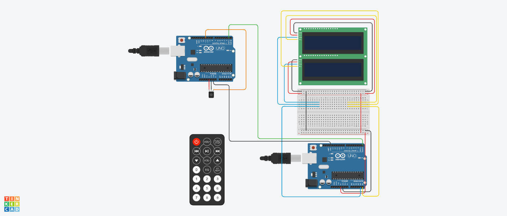

# Arcade Game: Two-Arduino Lane Dodger (Tinkercad)

This is a simple arcade-style dodging game built in Tinkercad Circuits. The player is an arrow character that sits in a fixed position on a three-lane road. Obstacles scroll toward the player from the right, and an infrared remote moves the arrow up or down between lanes to avoid them. The score increases on every step the player survives, and the game speeds up as the score climbs.

The point of the project is not the game itself. It is the architecture. The work is split across two separate Arduino Uno boards that each do one job and pass information from one to the next: one board reads the remote and runs the game rules, and one board drives the screen. Real arcade cabinets and game consoles were built the same way, with a main processor and a dedicated graphics chip, because one slow processor cannot calculate a game world and repaint a screen fast enough on its own. The display is made from two 16x2 LCD modules stacked vertically so they behave as a single 16x4 screen.

This is version 2. Version 1 used three boards, with a whole microcontroller dedicated to reading two pushbuttons and reporting them to the game logic over two plain digital wires. That board is gone. The reason it could go is the most interesting thing about this version, and it is explained in the next section. Version 1 remains available as a tagged release.

🔗 **Tinkercad simulation:** [open the circuit](https://www.tinkercad.com/things/947zUC6zh8O-remote-controlled-arcade-game)



---

## Why one board disappeared

Version 1 spent an entire Arduino on two pushbuttons. That board did three things: it debounced the switches, it turned a held button into a single clean event, and it held an output pin HIGH so the next board could see the result.

An infrared remote does all of that work before the signal ever reaches the Arduino. The remote encodes which button was pressed as a number and transmits it. The receiver module strips out the carrier. The library decodes the pulses into a command byte, and separately flags whether the button is merely being held down. There is nothing left for a dedicated input board to do, so the receiver connects straight to the game logic board.

| | Version 1, two buttons | Version 2, IR remote |
|---|---|---|
| Boards | 3 | 2 |
| Wires carrying input | 2, one per button | 1, for the whole keypad |
| Time to register a press | Under 1 ms | About 67 ms |
| Inputs available | 2, and a new wire for each extra one | 21, with no extra wiring |
| Debounce | 20 ms `delay()` on Arduino A | Handled inside the protocol |


---

## How it works

The two boards form a one-way chain. Information only ever travels in one direction: B to C. Arduino C never sends anything back. This keeps the wiring simple and means neither board has to wait for a reply.

| Board | Job | Gets input from | Sends output to |
|---|---|---|---|
| Arduino B | Input decoding and game logic. Reads the remote, holds the road, moves the player, spawns obstacles, detects crashes, keeps score. | IR receiver module | Arduino C, over a serial data link |
| Arduino C | Display driver. Receives a full picture of the screen and paints it onto the two LCDs. | Arduino B | The two LCD modules, over I2C |

The boards keep their version 1 letters. There is no Arduino A any more, and B is no longer in the middle of anything, but renaming them would break every pin reference in the sketch comments and in this document for no real gain.

The two links in this project work in completely different ways, and it is worth understanding why.

**The remote to B uses an encoded protocol.** The remote transmits infrared light pulsed on and off at 38 kHz. The receiver module detects that specific flicker rate and ignores other infrared light, which is how it tells a remote apart from sunlight or a lamp. It hands the Arduino a stream of timed pulses, and the IRremote library measures the gaps between them to reconstruct a number: an address identifying the device, and a command byte identifying which button was pressed. Because every button carries its own number, one receiver pin supports the entire keypad.

**B to C uses serial.** Serial means sending data one bit at a time down a single wire, at an agreed speed. Both boards are set to 9600 baud, which means 9600 bits per second. B sends the entire screen as a block of characters every time something changes.

### Remote buttons

Only four buttons are used. Every other button is decoded and then ignored.

| Button | Command byte | What it does |
|---|---|---|
| Power | `0x00` | Starts a new game, or restarts after a crash |
| Pause / play | `0x05` | Freezes the game, press again to resume |
| Triangle down | `0x08` | Moves the player down one lane |
| Triangle up | `0x0A` | Moves the player up one lane |

⚠️ **These codes are specific to Tinkercad's simulated remote.** Tinkercad numbers the buttons sequentially from `0x00` by their position on the keypad. A physical remote of the same layout sends standard NEC command bytes instead, which are entirely different numbers. If this project is ever built on real hardware, all four constants must be rediscovered using the dumper sketch described in the test procedure.

### Game states

The game on Arduino B is a state machine. A state machine means the program is always in exactly one named state, and it only responds to input in the way that state allows. Version 1 had three states. Version 2 has four, because the remote made a pause button free.

| State | Number | Bottom line of screen shows | Which buttons do anything |
|---|---|---|---|
| Waiting | 0 | `Press PWR start` | Power starts a new game |
| Playing | 1 | `Score: <n>` | Up and down move a lane, pause freezes |
| Crashed | 2 | `CRASH! Score <n>` | Power restarts, but only after 1 second |
| Paused | 3 | `PAUSED Score <n>` | Pause resumes, power abandons the game |

The 1 second lockout after a crash exists so that the keypress that caused the crash does not immediately restart the game before the player has read their score.

Pause works by simply not being state 1. The obstacle timer sits behind its own `state == 1` guard rather than being nested inside the input handling, so a paused game stops moving without any extra code. On resume the sketch resets `lastTick = millis()`. Without that line the elapsed time has been growing the whole time the game was paused, so the first comparison after resuming is instantly true and the game jumps a step the moment it unfreezes.

Arduino C knows nothing about any of this. It receives 66 bytes and paints them. Adding a fourth state changed only the text Arduino B writes into the status line, which is why the display sketch is byte-for-byte unchanged from version 1.

### Frame format

A "frame" is one complete picture of the screen, sent as a single message. Arduino B builds the frame and Arduino C draws it. The frame is always exactly 66 bytes. **This format is unchanged from version 1.**

| Part | Size | Meaning |
|---|---|---|
| `{` | 1 byte | Start marker. Tells C that a new frame is beginning. |
| Road data | 48 bytes | 3 lanes of 16 characters each. A space is empty road, `#` is an obstacle. |
| Status line | 16 bytes | The bottom row of text, padded to exactly 16 characters. |
| `}` | 1 byte | End marker. Tells C the frame is complete and safe to draw. |

The start and end markers are what make the link reliable. If C is switched on halfway through a frame, it will see characters with no `{` before them and throw them away. It only draws when it has received a `{`, exactly 64 characters, and then a `}`. A damaged frame is discarded rather than drawn as garbage.

The player character is not stored in the road array. Arduino B inserts it into the frame as it is being sent, at lane `playerLane`, column 1. It is drawn as `>` while playing or paused, and `X` after a crash.

That the entire input half of the project was replaced without touching the display sketch is the clearest argument for defining the interface properly in version 1. The boards agree on 66 bytes and nothing else, so either side can be rebuilt independently.

### How the 16x4 screen is built

Each LCD module is 16 characters wide and 2 rows tall. Stacking two of them gives 4 rows. Arduino C converts the position in the 64-character frame into a physical LCD and row.

| Frame positions | Screen row | Physical LCD | Row on that LCD | Contents |
|---|---|---|---|---|
| 0 to 15 | 0 | Top | 0 | Road lane 0 |
| 16 to 31 | 1 | Top | 1 | Road lane 1 |
| 32 to 47 | 2 | Bottom | 0 | Road lane 2 |
| 48 to 63 | 3 | Bottom | 1 | Status line |

Note that the road straddles the gap between the two modules. Lane 2, the bottom lane of the road, is physically on the second LCD. This means the two modules must be mounted directly against each other with no gap, or the road will look broken.

### Timing method

The project does not measure any physical quantity such as voltage or temperature. What it does manage is time. These are the timings the design depends on.

| Quantity | How it is controlled |
|---|---|
| Debounce | Not needed. There is no mechanical switch anywhere in the circuit. |
| Held button rejection | The `IRDATA_FLAGS_IS_REPEAT` flag from the library, checked on every decode |
| Double-decode rejection | A 120 ms `KEY_GAP` guard on Arduino B, comparing `millis()` to the last accepted press |
| Game speed | A `millis()` timer on B, starting at 400 ms per step |
| Difficulty increase | Tick interval reduced by 30 ms for every 20 points scored |
| Screen refresh rate | A `millis()` throttle on B, sending at most one frame every 100 ms |
| Restart lockout | 1000 ms measured from the moment of the crash |

`millis()` returns the number of milliseconds since the board was switched on. Comparing `millis()` against a stored value is how an Arduino waits for a period of time without using `delay()`, which would freeze everything else.

Note that version 1's 20 ms debounce `delay()` is gone entirely, along with the board it ran on. Nothing in version 2 calls `delay()` at any point.

---

## Design files

| File | What it is |
|---|---|
| [Schematic (PDF)](arcade-game.pdf) | The full circuit drawn as a schematic, exported from Tinkercad |
| [PCB board file (.brd)](arcade-game.brd) | The board layout file exported from Tinkercad, openable in Autodesk EAGLE or Fusion Electronics |
| [`arcade_logic_B.ino`](arcade_logic_B.ino) | Sketch for Arduino B, the remote decoding and game logic |
| [`arcade_display_C.ino`](arcade_display_C.ino) | Sketch for Arduino C, the display driver. Unchanged from version 1. |

`arcade_input_A.ino` no longer exists in this version. It is preserved in the version 1 release.

To load the code, open the Tinkercad circuit, click a board, open the Code panel, switch it to Text mode, and paste in the matching sketch. Each board needs its own sketch. Pasting the wrong sketch into a board will not damage anything, but nothing will work.

If you open these sketches in the desktop Arduino IDE instead, each `.ino` file must sit inside a folder of the same name. That is a rule of the Arduino IDE, not of this project.

---

## Parts

| Part (Tinkercad name) | Qty | Settings |
|---|---|---|
| Arduino Uno R3 | 2 | Default |
| LCD 16x2 (I2C) | 1 | Address `0x20` (the default) |
| LCD 16x2 (I2C) | 1 | Address `0x21` |
| IR sensor | 1 | Default |
| IR remote | 1 | Default |
| Breadboard Small | 1 | Default |
| Hookup wires | As needed | Colour coded by function |

The two LCD addresses must be different. I2C is a shared bus, which means both displays are wired to the exact same two signal wires. The only thing that lets Arduino C talk to one without the other answering is the address. If both modules are left on `0x20`, both will respond to every message and the same text will appear on both screens.

On real hardware the equivalents would be:

- Two Arduino Uno R3 boards, or cheaper Nano boards, since neither uses many pins
- Two I2C 16x2 LCD modules based on the PCF8574 backpack chip, with their address selected by solder jumpers marked A0, A1 and A2 on the back of the module
- A 38 kHz infrared receiver module such as a TSOP1738 or VS1838B. The carrier frequency matters: a 36 kHz or 56 kHz part will not reliably decode a 38 kHz remote.
- Any NEC-protocol remote, including the cheap black ones bundled with Arduino starter kits. Its button codes will not match the ones in this document.

---

## Wiring

### Arduino B, remote decoding and game logic

| Pin | Purpose | Connection |
|---|---|---|
| D11 | IR signal in | OUT pin of the IR receiver module |
| D1 (TX) | Serial data out | Arduino C, D0 (RX) |
| 5V | Receiver power | VCC pin of the IR receiver module |
| GND | Receiver ground | GND pin of the IR receiver module |
| GND | Shared reference | Arduino C, GND |
| A0 | Unused, left floating on purpose | Nothing |

Pin A0 is deliberately left unconnected. The sketch calls `randomSeed(analogRead(A0))` at startup. An unconnected analogue pin picks up tiny random electrical noise, and reading it gives a different number every time the board starts. That number is used to make the obstacle pattern different on each run. If A0 were wired to 5 V or GND it would read the same value every time and every game would have identical obstacles.

D11 has nothing special about it. The IRremote library can receive on any digital pin. It was chosen because it sits well away from D0 and D1, which keeps the receiver's two wires from crossing the serial wire on the board.

### Arduino C, display driver

| Pin | Purpose | Connection |
|---|---|---|
| D0 (RX) | Serial data in | Arduino B, D1 (TX) |
| A4 (SDA) | I2C data line | SDA pin of both LCD modules |
| A5 (SCL) | I2C clock line | SCL pin of both LCD modules |
| 5V | Display power | VCC pin of both LCD modules |
| GND | Display ground | GND pin of both LCD modules |
| GND | Shared reference | Arduino B, GND |

### Grounds

| From | To |
|---|---|
| Arduino B GND | Arduino C GND |

Both boards must share a ground connection. A digital signal is a voltage, and a voltage is always measured between two points. Without a shared ground, Arduino C has no common reference against which to judge whether B's signal wire is at 5 V or 0 V, and the readings become meaningless. This is the single most common reason that two microcontrollers fail to talk to each other.

⚠️ **This is how version 2 broke during development** Version 2 was built by copying the version 1 circuit and deleting Arduino A. In version 1 the shared ground ran A to B and B to C, chained through the breadboard. Deleting Arduino A took its wires with it, and the chain broke in the middle. Both boards still worked perfectly on their own: Arduino B's serial monitor showed clean frames scrolling past, and Arduino C powered up, found both displays and printed `Waiting for B...`. The link between them was silently dead, and the only visible symptom was a startup message that never went away. Deleting a component removes every wire attached to it, including wires that were doing a job for something else entirely.

### Connections that must NOT be made

⚠️ **Do not connect the 5V pins of the two Arduinos together.** Each board is powered separately through its own USB connection. Tying their 5 V rails together means two regulators fighting to set the same voltage, which can damage them on real hardware. Ground is the exception and must be shared.

⚠️ **Do not connect TX to TX or RX to RX.** Serial is always crossed. The transmitting pin of one board goes to the receiving pin of the other. B's D1 goes to C's D0. Wiring TX to TX means both boards shout and neither listens.

⚠️ **Do not wire the IR receiver to D0 or D1 on Arduino B.** Those are the serial pins carrying the frame data. The receiver would fight the outgoing transmission and neither the remote nor the screen would work.

⚠️ **On real hardware, unplug the wire between B's TX and C's RX before uploading code to Arduino C.** Pins D0 and D1 are the same pins the USB cable uses to upload a sketch. Leaving the wire attached means B's game data collides with the upload and the upload fails. This does not apply in Tinkercad, where there is no physical upload.

---

## Finding the remote's button codes

The four command bytes in this document were not guessed. They were read off the remote using a throwaway sketch on a separate circuit containing nothing but an Arduino and an IR receiver.

```cpp
#include <IRremote.hpp>
void setup() {
  Serial.begin(9600);
  IrReceiver.begin(11, DISABLE_LED_FEEDBACK);
}
void loop() {
  if (IrReceiver.decode()) {
    if (!(IrReceiver.decodedIRData.flags & IRDATA_FLAGS_IS_REPEAT)) {
      Serial.print("command 0x");
      Serial.println(IrReceiver.decodedIRData.command, HEX);
    }
    IrReceiver.resume();
  }
}
```

This has to be done on a separate circuit, not on Arduino B. On B the serial port is the data link to the display, so anything printed for debugging is also transmitted down the wire to Arduino C. Printing plain hex is mostly harmless because C discards characters outside a frame, but the library's own `printIRResultShort()` prints braces, and a stray `{` or `}` arriving mid-frame will corrupt the picture.

Two things to watch for when adapting this to a different library version. Tinkercad now ships IRremote 4.x, where the header is `IRremote.hpp` and the decoded value lives in `IrReceiver.decodedIRData.command` as a single byte. Older guides online use IRremote 2.x, with `IRremote.h`, an `irrecv` object and a `decode_results` struct whose `.value` holds a full 32-bit word such as `FFA25D`. The two are not interchangeable, and a 32-bit value cannot be compared against a one-byte command.

---

## Test procedure

1. Open the circuit in Tinkercad and confirm both boards, both LCDs, the IR receiver and the remote are present. Nothing should be visibly disconnected.
2. Confirm the ground wire between Arduino B and Arduino C exists. This is the connection most likely to be missing after any edit to the circuit.
3. Paste each sketch into its matching board using the Code panel in Text mode. Check twice that B's sketch is on B and C's is on C.
4. Click **Start Simulation**. Both LCD backlights should come on and the top LCD should briefly show `Waiting for B...`.
5. Within a second the screen should be replaced by the game's waiting screen. The bottom row should read `Press PWR start` and an arrow `>` should be visible on the middle row, near the left edge. **If `Waiting for B...` stays on screen, no serial data is arriving. Check the ground wire first, then that the link runs from B's D1 to C's D0 and not pin to matching pin.**
6. Press Power on the remote. The bottom row should change to `Score: 0` and obstacles marked `#` should begin appearing at the right edge and sliding left.
7. Press the up triangle. The `>` should move up one lane. Press it again at the top lane. The arrow should stay put and not disappear off the screen.
8. Press the down triangle. The `>` should move down one lane, including down onto the second physical LCD, which is the third lane of the road.
9. Press and hold the up triangle. The arrow should move exactly once, not repeatedly, because repeat frames are rejected.
10. Press a number key or any other unused button. Nothing at all should happen.
11. Press pause. The obstacles should freeze and the bottom row should read `PAUSED` with the current score. Press pause again. The game should resume from exactly where it stopped, without skipping a step.
12. Let an obstacle reach the player's column without moving out of the way. The arrow should change to `X` and the bottom row should show `CRASH!` with the final score.
13. Press Power immediately after the crash. Nothing should happen. Wait one second, press again, and a fresh game should start with the score back at 0.
14. Play long enough to reach a score of 20 or more and watch whether the obstacles visibly move faster than at the start.

---

## Results and observations

- The game runs in the Tinkercad simulation. The `>` player character moves up and down between lanes in response to the remote, and obstacles can be avoided by moving out of their lane.
- The arrow moves across the boundary between the two LCD modules correctly, which confirms the 64-character frame is being mapped to the right physical display and row.
- Arduino B produces well-formed frames continuously. Read directly from B's serial monitor, the stream shows the road characters, the status line and the `}{` boundary where one frame's end marker meets the next frame's start marker.
- The display sketch was carried over from version 1 without a single edit and worked immediately once the ground was restored, which confirms the frame interface is genuinely independent of how input is collected.
- Scores above 30 were reached during testing. Crash detection, the restart lockout and the speed increase at 20 point intervals: TODO_OBSERVED_BEHAVIOUR. These were not separately verified against the clock and are recorded here as untested rather than working.
- Highest score reached: TODO_MEASURED_VALUE.

### Frame transmission time

The screen refresh rate is limited by how fast 66 bytes can be pushed down a 9600 baud serial link. Standard Arduino serial sends 8 data bits wrapped in 1 start bit and 1 stop bit, so each byte costs 10 bits on the wire, not 8.

$$t_{frame} = \frac{66 \times 10}{9600} = 0.0688\ \text{s} \approx 69\ \text{ms}$$

Arduino B is set to send at most one frame every 100 ms. Since a frame takes about 69 ms to transmit, there is roughly 31 ms of spare time between frames. The link is running at about 69% capacity, so the throttle is safe but not generous.

The theoretical maximum refresh rate of this link is:

$$f_{max} = \frac{1}{0.0688} \approx 14.5\ \text{frames per second}$$

The 100 ms throttle caps the actual rate at 10 frames per second.

### Infrared frame time

A single NEC infrared transmission is a fixed-length thing, and its duration can be calculated rather than measured. It opens with a 9 ms burst and a 4.5 ms space, then sends 32 bits. Every bit starts with a 0.5625 ms burst, followed by a 0.5625 ms space for a zero or a 1.6875 ms space for a one, giving 1.125 ms and 2.25 ms respectively.

The 32 bits are an 8-bit address, its inverse, an 8-bit command, and its inverse. Because each byte is sent alongside its own inverse, exactly 16 of the 32 bits are ones and 16 are zeros, no matter which button is pressed. Every button therefore takes the same time to transmit:

$$t_{IR} = 9 + 4.5 + (16 \times 1.125) + (16 \times 2.25) = 67.5\ \text{ms}$$

This is the floor on input latency, and it cannot be reduced by changing any code. It is comfortably inside the 400 ms starting tick, and still inside the 130 ms floor the tick eventually reaches, so the remote never limits play.

### Minimum game tick interval

The tick interval starts at 400 ms and drops by 30 ms every time the score is an exact multiple of 20, while the interval is above 150 ms. Working through the sequence:

| Score | Tick interval |
|---|---|
| 0 | 400 ms |
| 20 | 370 ms |
| 40 | 340 ms |
| 60 | 310 ms |
| 80 | 280 ms |
| 100 | 250 ms |
| 120 | 220 ms |
| 140 | 190 ms |
| 160 | 160 ms |
| 180 | 130 ms |
| 200 and above | 130 ms, no further change |

The guard in the code is `tickTime > 150`. At a score of 180 the interval is still 160 ms, which passes the test, so it drops a final time to 130 ms. The true floor is therefore 130 ms and not 150 ms as the comment in the code implies. This was found by working through the arithmetic, not by playing to a score of 180.

### Obstacle warning time

An obstacle spawns in column 15 and the player sits in column 1, so it travels 14 columns before reaching the player. At the starting speed:

$$t_{warning} = 14 \times 400\ \text{ms} = 5.6\ \text{s}$$

At the fastest speed:

$$t_{warning} = 14 \times 130\ \text{ms} = 1.82\ \text{s}$$

Subtracting the 67.5 ms infrared delay leaves 1.75 s of genuine reaction time at the fastest speed, so the remote costs under 4% of the available window.

---

## Known issues and limitations

- Crash detection, the restart lockout and the speed increase are written and appear to work, but have not been verified carefully. They are marked as TODO above rather than claimed as working.
- The project has only ever been run in the Tinkercad simulator. It has never been built with real components, so nothing here accounts for real world problems such as wire resistance, infrared interference from sunlight or fluorescent lighting, or LCD modules with the wrong address soldered.
- The button codes are Tinkercad's, not the real remote's. Anyone building this physically must rediscover all four. This is a genuine portability problem that version 1's pushbuttons did not have, since a button pressed is a button pressed on any hardware.
- The serial link has no error checking beyond the start and end markers. There is no checksum and no acknowledgement. If a byte is lost the whole frame is silently dropped and the screen holds the previous picture until the next frame arrives.
- Communication is one way only. Arduino B has no idea whether C is powered on, connected or drawing anything. If C fails, B carries on playing a game nobody can see. This is exactly what happened during development, and it took a while to notice because B looked perfectly healthy throughout.
- Serial on Arduino B is both the data link and the only debugging channel. Debugging the game logic means either accepting that the debug text is also being transmitted to the display, or moving the link to `SoftwareSerial` on a spare pin.
- Two whole microcontrollers for a game this simple is still overkill. A single Arduino could run all of it. The split exists to demonstrate the architecture, not because it is necessary.
- There is no sound, no lives system, no difficulty selection and no high score that survives a power cycle.
- The wiring for this project was designed and built by me. The code was written with AI assistance, then read through and commented for clarity. The code is presented here as working simulation code, not as code I wrote line by line.

### Resolved since version 1

- The obstacle lane is now chosen with `random(3)`, which works correctly. Version 1 used `random(300) / 100` with a `lane > 2` safety check, kept because of a problem that was never recorded. The direct version was tested in version 2 and showed no fault, so the workaround and its safety check have both been removed.
- The misleading LEFT and RIGHT naming is gone. The constants are `KEY_UP` and `KEY_DOWN`, which match what they actually do.
- Version 1's listed improvement about replacing the two signal wires so that more than two buttons could be supported is now done. The remote supports 21 buttons on one wire, and the pause function this version adds cost no wiring at all.

---

## Things I learned

- When a dedicated stage in a pipeline is worth having, and when it is not. A board that cleans up a raw signal earns its place. A board that cleans up an already-decoded signal is just a delay.
- That a well-defined interface is what makes a rewrite cheap. The entire input half of this project was replaced and the display sketch did not change by one character, because the two boards had only ever agreed on 66 bytes.
- Why all boards in a system must share a ground.
- That deleting a component in a schematic deletes its wires, and some of those wires may have been doing a job for parts that are still there.
- How to debug a link where both ends look healthy. Arduino C's startup message turned out to be the useful clue: it proved C was alive and had never received a single byte, which ruled out power and I2C in one step and pointed straight at the connection between the boards.
- Real systems solve this same problem the same way. Arcade cabinets and early games consoles used a separate chip for graphics so the main processor never had to spend time painting the screen. Modern cars use a shared bus so dozens of small controllers, each responsible for one part of the car, can pass messages without one central computer doing everything.

---

## Future improvements

- Verify crash detection, the restart lockout and the speed increase properly, and replace the TODO placeholders with real observations.
- Lower the frame throttle from 100 ms to around 80 ms so the display can keep up with the game at its fastest speed, since the link has the spare capacity.
- Add a checksum byte to the frame so Arduino C can detect a corrupted frame rather than trusting any 64 characters that arrive between the markers.
- Move the B to C link onto `SoftwareSerial` so the hardware serial port stays free for debugging without transmitting debug text to the display.
- Use the number keys the remote already provides for a difficulty selection, choosing the starting tick interval. This costs no wiring at all, which is the whole point of the change this version made.
- Add a buzzer on Arduino B for crash and scoring sounds, using a pin freed up by removing the button inputs.
- Store the high score in the Arduino's EEPROM so it survives a power cycle.
- Replace the two stacked 16x2 modules with a single 20x4 LCD, which removes the physical seam running through the middle of the road.
- Build the circuit on real hardware and record what breaks, which is usually the grounds, the LCD addresses and the remote's button codes.

---

## Version history

| Version | Boards | Input | Notes |
|---|---|---|---|
| v1 | 3 | Two pushbuttons on a dedicated input board |  Original three-board architecture |
| v2 | 2 | IR remote direct to the game logic board |  Adds pause and a dedicated start button. |

---

## License

MIT
